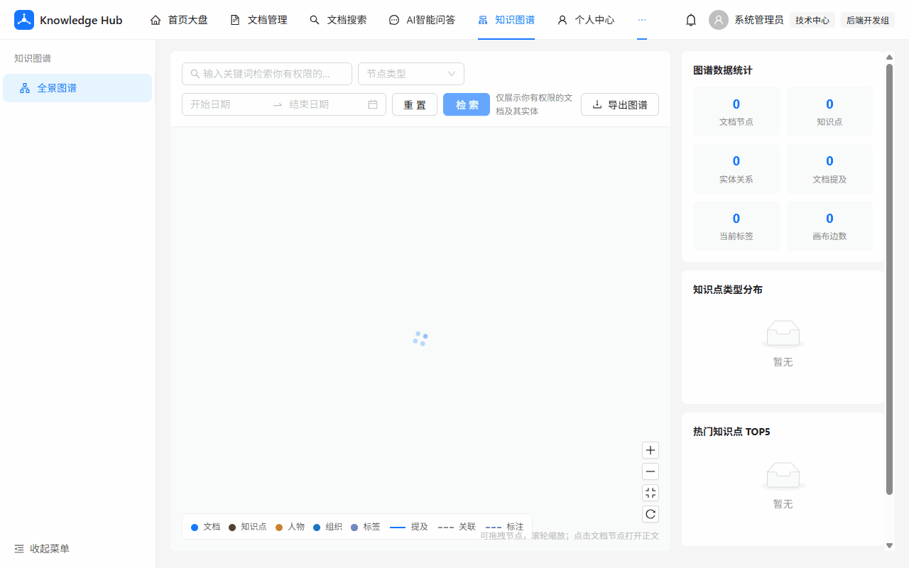
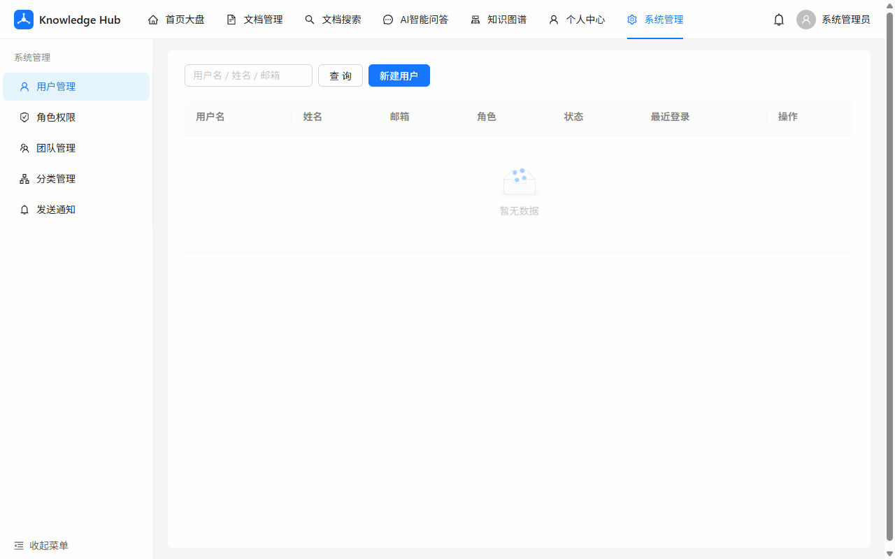
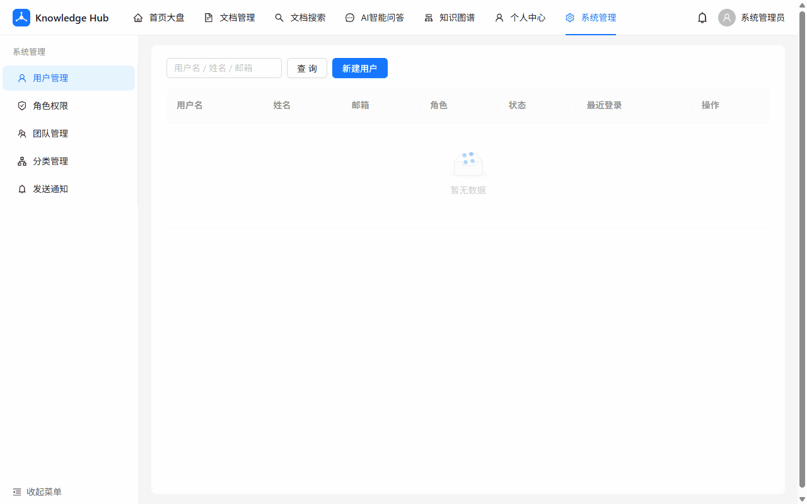
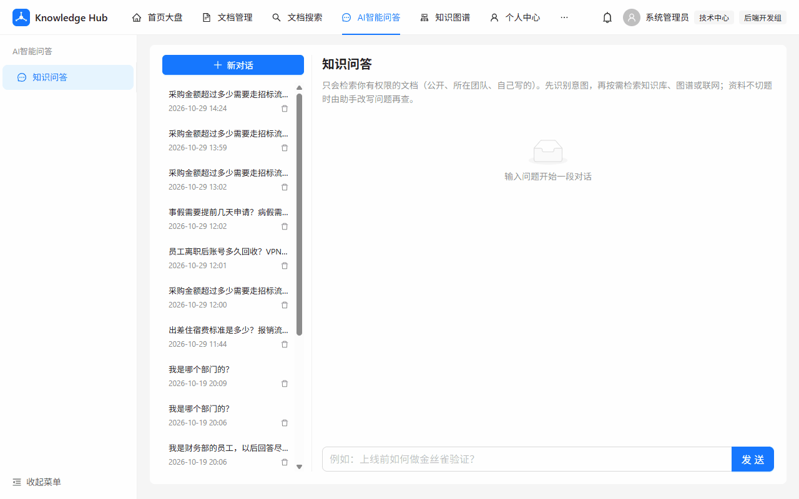
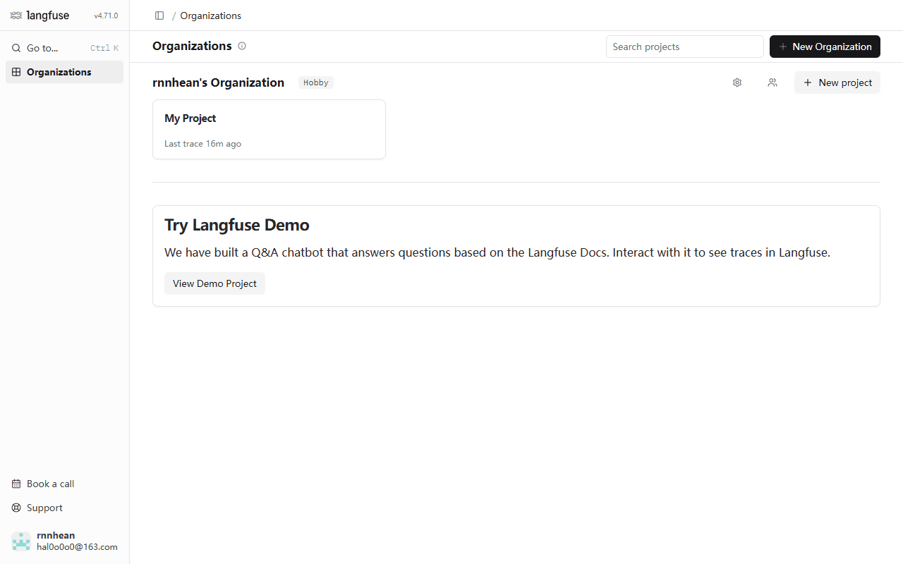

# knowledge-hub-frontend

`knowledge-hub-backend` 的管理端 / 使用端前端：React 19 + Vite 8 + Ant Design 6 + TypeScript，对接知识库的文档管理、全文检索、RAG 智能问答、知识图谱与权限审核体系。

## 技术栈

| 层 | 选型 |
|---|---|
| 框架 | React 19 + TypeScript |
| 构建 | Vite 8 |
| UI | Ant Design 6 |
| 路由 / 状态 | React Router + 本地持久化 |
| 可视化 | 知识图谱力导向图 |
| 流式 | SSE（`fetch` + ReadableStream 逐块渲染） |
| 代码检查 | oxlint |

## 功能演示

以下动图按真实操作流程录制（1280×800，均为本地全栈运行时的实际画面，文中制度文档为虚构示例数据）。

### 1. 登录

账号密码登录，签发 access / refresh token，前端持久化后自动续期。


### 2. 文档管理

文档列表 → 详情预览。文档有草稿 / 待审核 / 已发布 / 已归档四种状态，上传后解析入库、发布后异步构建索引。


### 3. 全文检索

关键词检索走后端混合召回（BM25 + 向量 kNN），结果按相关度排序并高亮命中片段。


### 4. 知识图谱

从文档中抽取的实体与关系做可视化，支持按实体检索关联链路。



### 5. 权限与审核

用户 / 角色 / 团队管理，以及审核工作台：待审核文档 → 通过 / 驳回，通过后触发索引重建。



管理员新建账号：填用户名 / 密码 / 姓名 / 邮箱并分配角色，创建后立即生效（默认角色「普通用户」）。



### 6. RAG 智能问答

流式输出答案，正文里的 `[1] [2]` 是可点击的引用溯源，落到具体文档与片段；答案下方附本次召回的资料列表。

检索侧是 Agentic 流程：query 改写 → 混合召回 → RRF 融合 → 重排 → 切题评估（不切题则带反馈重试）。



### 7. 全链路观测（Langfuse）

每次问答的完整 trace 会上报到 Langfuse：可以看到 LangGraph 编排的每一层 span（意图分类 → 检索与切题评估 → 生成），以及改写后的 query、召回文档标题、评估结论与各阶段耗时。



## 本地运行

后端先起在 `http://localhost:3000`。

```bash
pnpm install
pnpm dev
```

浏览器打开 `http://localhost:5173`。开发时 `/api` 会代理到 3000。

预置账号：`user` / `123456`（文档与检索），`admin` / `123456`（系统管理），`reviewer` / `123456`（审核）。

新增账号有两种方式：管理员在「用户管理」里新建；或直接调后端 `POST /auth/register`（后端已实现，支持可选的邮箱激活，`REQUIRE_EMAIL_VERIFICATION=true` 时生效，默认关闭）。前端目前没有注册 / 忘记密码页面。

## 已对接接口

- 登录 / 资料 / 改密（access + refresh token）
- 文档列表、新建、编辑、发布、归档、下架、删除、上传解析
- 全文搜索 `POST /search`
- RAG 问答 `POST /ai/chat`（SSE 流式）、仅检索 `POST /rag/search`
- 图谱检索 / 实体 / 关系
- 用户、角色权限、团队、审核工作台
